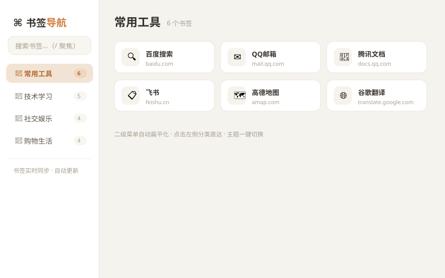
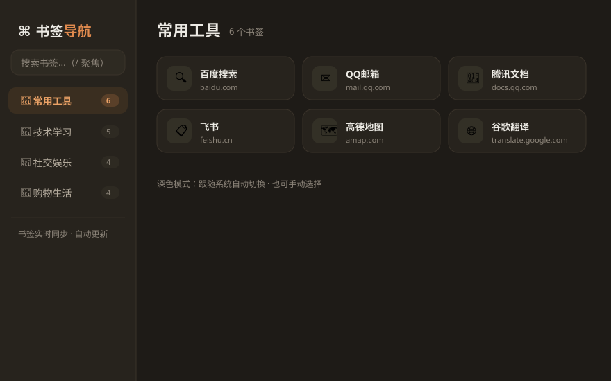

# ⌘ 书签导航页（Edge 新标签页）

> 把浏览器书签变成美观的新标签页导航：**书签实时同步、自动更新**，二级菜单自动扁平化，支持**浅色 / 深色 / 跟随系统**三种主题，还能拉取远程导航分组。全部数据留在本机，不上传任何服务器。

**[🚀 在线体验 Demo](https://zzw3675.github.io/edge-bookmark-nav/)（内置示例数据，无需安装，直接体验界面效果）**

---

## ✨ 功能特性

| 特性 | 说明 |
| --- | --- |
| 🔄 书签实时同步 | 直接读取 Edge 收藏夹，增删改后新开标签页即最新 |
| 📂 二级菜单扁平化 | 子文件夹自动提升为一级分类，全部显示在左侧栏，点选直达 |
| 🌓 三模式主题 | 跟随系统 / 浅色 / 深色，一键切换并记忆选择 |
| 🖼️ 网站真实图标 | 自动加载各站点 favicon，缺失时回退为首字母色块 |
| 🌐 远程导航分组 | 可配置内网 / 公网导航站地址，自动拉取其链接作为分组 |
| 🔍 快速搜索 | 输入即过滤，`/` 聚焦搜索框，`Esc` 清空 |

## 📸 界面预览

**浅色模式：**



**深色模式（跟随系统深色自动切换）：**



> 上图为界面示意图；安装后展示的是你自己 Edge 里的真实书签，按文件夹自动分组。

## 📦 安装方法（Edge 浏览器）

1. 点击仓库右上角 **Code → Download ZIP**，下载后解压
2. Edge 地址栏输入 `edge://extensions` 并回车
3. 打开左下角 **「开发人员模式」** 开关
4. 点击 **「加载解压缩的扩展」**，选择解压出来的文件夹
5. 完成。**新建一个标签页**，就是你的书签导航页

## ⚙️ 配置远程导航分组（可选）

编辑 `newtab.js` 顶部的 `REMOTE_SOURCES`，按需添加地址：

```js
const REMOTE_SOURCES = [
  { id: "r1", name: "我的内网导航", url: "http://192.168.1.100:8080/" },
];
```

同时在 `manifest.json` 的 `host_permissions` 中加入该地址（否则浏览器会因跨域限制拉取失败）：

```json
"host_permissions": ["http://192.168.1.100:8080/*"]
```

## ❓ 常见问题

- **看不到书签？** 确认 Edge 已登录账号并开启了书签同步
- **网站图标不显示？** 部分网站未提供 favicon，会自动显示首字母色块
- **想换主题？** 点击侧栏右上角的 🌓 按钮，循环切换跟随系统 / 浅色 / 深色
- **书签顺序？** 侧栏顺序自动跟随 Edge 收藏夹里的文件夹排列顺序

## 🛠️ 技术说明

- Manifest V3 Chrome 扩展，兼容 Edge / Chrome 等 Chromium 内核浏览器
- 纯本地运行，`bookmarks` 权限用于读取收藏夹，不联网上传任何数据
- 无需构建，无需依赖，零配置开箱即用

## 📄 许可证

[MIT](LICENSE) © zzw3675
